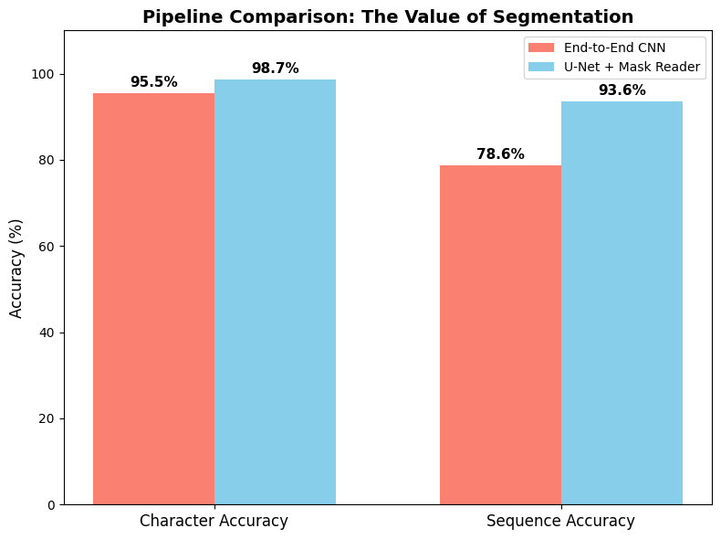

# Two-Stage CAPTCHA Solver with U-Net Segmentation

A deep learning pipeline that reads 5-digit CAPTCHAs with overlapping, rotated characters, Gaussian noise, and sinusoidal distractor lines. The data is synthetic and generated on the fly with OpenCV.

## Pipeline

1. **Segmentation:** a lightweight `MicroUNet` (3-level encoder/decoder with skip connections) predicts a 12-class pixel mask: background, digits 0-9, and overlap regions.
2. **Binarization:** the predicted mask is converted to a clean 0/1 text mask.
3. **Sequence recognition:** a CNN with 5 parallel MLP heads (one per character position) reads the digits from the binary mask.

A baseline CNN with the same architecture reads the raw RGB image directly, as an ablation of the segmentation stage.

## Results (500 unseen CAPTCHAs)

| Model | Character accuracy | Sequence accuracy |
|---|---|---|
| End-to-end CNN (baseline) | 95.5% | 78.6% |
| U-Net + mask reader (proposed) | 98.7% | 93.6% |



## Usage

```bash
pip install -r requirements.txt
jupyter notebook captcha_segmentation.ipynb
```

A GPU is recommended. Training takes 10 epochs per model on 8,000 / 5,000 / 8,000 generated samples.

## Notes

Originally developed for a deep learning course assignment (HW2). The notebook is self-contained; no external dataset is needed.
